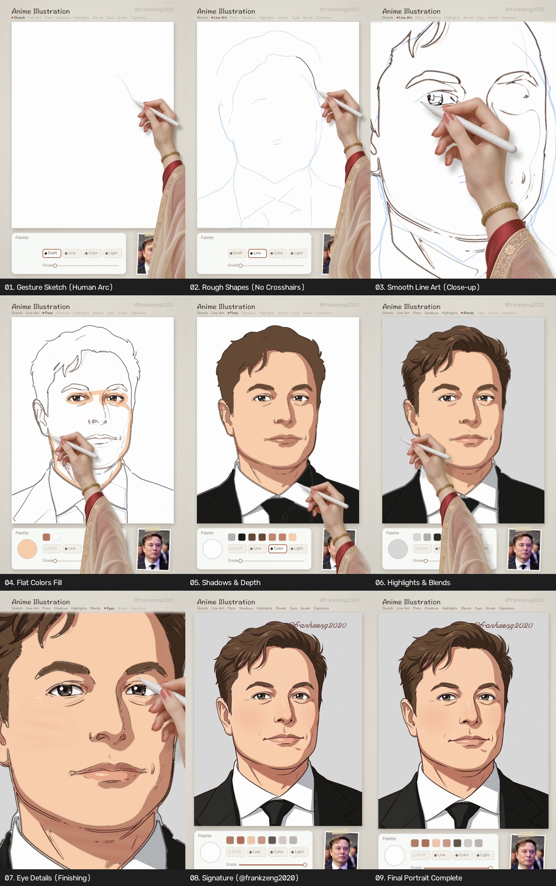

# Photo to Hand-Drawn Video (photo-to-handdraw-video)

[](https://opensource.org/licenses/MIT)
[](https://www.python.org/downloads/)
[](./SKILL.md)

Convert any portrait photo into a realistic Apple Pencil hand-drawn anime illustration demonstration video (1080×1920 vertical format) with human stroke simulation, iPad UI timeline, camera zooms, author signature, and original procedural background music.

把任意人物照片转换成极具拟真度的高清数字平板手绘过程视频（1080×1920 竖屏），模仿真人画师在 iPad 上使用 Apple Pencil 运笔、分层绘制、五官特写镜头推进、花体作者签名与全原创环境伴奏。

---

## 🎨 Demo / 成果展示

### 9-Stage Storyboard Breakdown / 九阶段绘制全景分镜


### Hand-Drawn Signature Verification / 花体签名与防截断校验


---

## ✨ Key Features / 核心特色

1. **模仿真人运笔（Natural Human Gesture）**
   - 彻底告别机械十字准星与规整数学椭圆；
   - 采用自然颅顶手腕弧线（Wrist Arc）与下颌切线模拟画师徒手起稿。
2. **压感连贯流线（Gaussian Streamline Smoothing）**
   - 全笔触施加 1D 高斯平滑滤波（$\sigma = 1.8$），消除像素阶梯与折线突变；
   - 智能过滤面颊与下颌周边 $< 55\text{px}$ 的微小毛刺杂桩。
3. **特写防残影镜头（Ghost-Free Camera Close-up）**
   - 画眼部五官时自动推进镜头放大；
   - 顶栏 UI 遮罩自适应锁定，消除特写时的文字双重叠影。
4. **全字符花体手写签名（Unclipped Signature）**
   - 自动在画布右上角由画笔手写签名（如 `@frankzeng2020`）；
   - 动态扩展渲染边界，确保多字符署名无裁剪、不漏字。
5. **纯 Python 原创 Lo-Fi 配乐（100% Original Procedural BGM）**
   - 无版权风险：内置 F 大调 74 BPM 温润电钢琴与柔和 Pad 琶音合成器；
   - 自动根据成片时长对齐并于片尾平滑淡出。
6. **全维度自动自检（Built-in Self-Inspection）**
   - 自动生成 9 宫格绘制全景分镜图与签名特写切片，方便自动化质检。

---

## 🚀 Quickstart / 快速开始

### 1. Prerequisites / 系统依赖
- Python 3.9+
- `ffmpeg` & `ffprobe` (for video encoding and audio muxing)

```bash
# macOS
brew install ffmpeg

# Ubuntu / Debian
sudo apt-get update && sudo apt-get install -y ffmpeg
```

### 2. Installation / 安装依赖
```bash
git clone https://github.com/topway-ai/photo-to-handdraw-video.git
cd photo-to-handdraw-video
pip install -r requirements.txt
```

### 3. Generate Video / 生成视频
```bash
python cli.py \
  --photo examples/elon_musk_reference.jpg \
  --name "elon-musk" \
  --author "@frankzeng2020" \
  --deliver ~/Desktop ~/Downloads
```

---

## 🤖 Install as AI Agent Skill / 作为 AI 技能安装

本项目完全遵循 **Agent Skill** 规范，内含完整的 [`SKILL.md`](./SKILL.md)。各大主流 Coding Agent 可直接无缝接入：

### Google Antigravity
将本仓库克隆至全局技能目录即可自动激活：
```bash
git clone https://github.com/topway-ai/photo-to-handdraw-video.git ~/.gemini/config/skills/photo-to-handdraw-video
```
或者在任意项目中作为工作区技能载入：
```bash
git clone https://github.com/topway-ai/photo-to-handdraw-video.git .agents/skills/photo-to-handdraw-video
```

### Claude Code / Cursor / Codex
直接将本仓库引入项目，或在指令中引导 AI 读取本仓库的 [`SKILL.md`](./SKILL.md)。

---

## 📋 CLI Parameters / 命令行参数说明

| 参数 | 说明 | 默认值 |
| :--- | :--- | :--- |
| `--photo` | **必填**。输入人物照片路径 | 无 |
| `--name` | 人物标识名称（如 `elon-musk`） | 图片文件名 |
| `--author` | 署名水印与手写签名文本 | `@frankzeng2020` |
| `--target` | 可选的已预先风格化的动漫插画 | 自动生成 |
| `--out` | 输出与中间缓存目录 | `./output/<name>` |
| `--deliver` | 最终成品自动同步复制的目录列表 | `['~/Desktop', '~/Downloads']` |
| `--mood` | 原创配乐风格（`warm`, `curious`, `calm`） | `warm` |
| `--length` | 视频节奏长度基准（秒） | `45` |

---

## 📁 Repository Structure / 目录结构

```
photo-to-handdraw-video/
├── SKILL.md                         # Agent Skill 规范定义与操作指南
├── README.md                        # 项目说明
├── LICENSE                          # MIT 开源协议
├── requirements.txt                 # Python 依赖清单
├── install.sh                       # 一键环境配置脚本
├── cli.py                           # 统一执行 CLI 入口
├── core/                            # 核心渲染与算法引擎
│   ├── anime.py                     # 人性化笔触规划与高斯平滑滤波
│   ├── film.py                      # 视频渲染、手部骨骼与特写镜头合成
│   ├── annotate.py                  # 智能五官标注与花体签名排版
│   ├── music_synth.py               # 纯 Python 过程式配乐合成器
│   └── paint.py                     # 笔刷动态仿真与压感混合
├── assets/
│   ├── hands/                       # 真实触控笔与画手模型
│   └── fonts/                       # 署名花体字体库
└── examples/                        # 示例输入与自检校验图片
```

---

## 📄 License

MIT License. See [LICENSE](LICENSE) for details.
